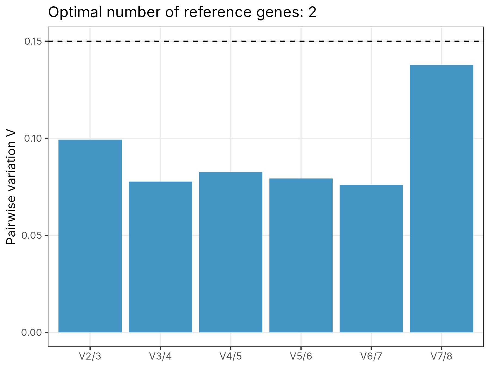
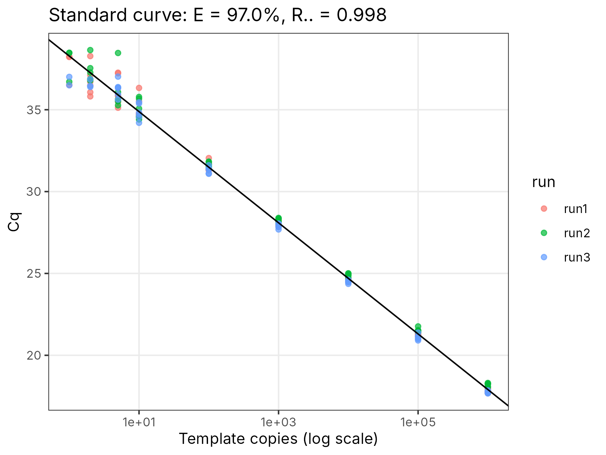
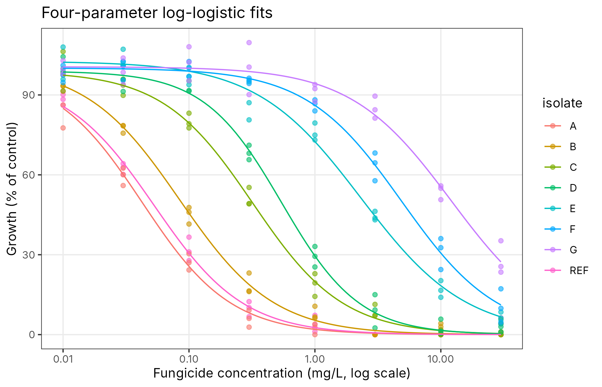

# qpcr-indicator-validation

R scripts for validating quantitative molecular indicators: qPCR reference-gene stability, assay performance (efficiency, LOD, LOQ, precision), diagnostic accuracy of genetic markers against a reference method, fungicide sensitivity (EC50 and resistance factors), and reproducibility of an indicator across environments with mixed models.

These are the statistical steps that sit between "we have a marker or an assay" and "we can trust it in routine use or in a report to an authority". Each module runs on its own, and a single config-driven script runs them together and writes a Markdown report.



## Modules

| File | Methods |
|---|---|
| `R/reference_gene_stability.R` | geNorm M and pairwise variation V(n/n+1) (Vandesompele et al. 2002); model-based NormFinder with inter-group shrinkage (Andersen et al. 2004); BestKeeper (Pfaffl et al. 2004); comparative ΔCt (Silver et al. 2006); consensus ranking by geometric mean of ranks. Efficiency-aware. |
| `R/assay_validation.R` | Standard curve, efficiency with CI and MIQE check; probit LOD95 with delta-method CI; LOQ from the CV of back-calculated quantities; repeatability and intermediate precision from `Cq ~ (1 \| run)` mixed models; efficiency-corrected relative expression (Pfaffl) with several reference genes. |
| `R/marker_validation.R` | Sensitivity, specificity, PPV, NPV and accuracy with Wilson intervals; Cohen's kappa; ROC with DeLong CI and Youden threshold; repeated stratified k-fold cross-validated AUC for single markers and multi-marker logistic models. |
| `R/dose_response.R` | Four-parameter log-logistic fits (drc LL.4 parameterisation, EC50 estimated on the log scale), EC50 CIs, resistance factors with CIs, and sensitivity classes. Uses base `nls` only. |
| `R/indicator_reproducibility.R` | `y ~ (1 \| entry) + (1 \| env) + (1 \| entry:env)` with lme4; variance components, entry-mean heritability / repeatability, ICC, parametric bootstrap CIs, BLUPs and Finlay–Wilkinson stability. |

## Quick start

```bash
Rscript install.R                                      # yaml, ggplot2, lme4, pROC, MASS, testthat
Rscript scripts/simulate_example_data.R data/example   # synthetic data with known truth
Rscript scripts/run_validation.R config/config.yaml
Rscript tests/testthat.R
```

Or `make all`. Delete any block from `config/config.yaml` to skip that module.

## Example results

The simulator plants known answers, which makes the example a check on the code as well as a demonstration.

**Reference genes.** Eight candidates with known noise levels, two of them shifted by treatment (GAPDH by 1.5 cycles, 18S by 0.8). All four methods place EF1a and UBQ at the top and GAPDH at or near the bottom, and geNorm recommends two genes. Normalising a target gene that was simulated with a 3-fold induction shows why this matters:

| Normaliser | Fungicide vs control | Heat vs control (true: no change) |
|---|---|---|
| EF1a + UBQ (recommended) | 2.9-fold (95% CI 2.2–3.7) | 1.0-fold, p = 0.79 |
| GAPDH (least stable) | 8.0-fold | 0.6-fold, p = 0.004 |

An unstable reference inflated the real effect almost threefold and created a false one.

**Assay.** Efficiency 97.0% (true 96.8%), R² 0.998. Probit LOD95 4.5 copies (CI 2.5–8.3), consistent with the Poisson limit of about 3 copies once pipetting losses are included; LOQ 10 copies.



**Markers.** The allele-specific qPCR marker reaches AUC 0.997 against the sequencing genotype (sensitivity 0.96, specificity 0.97, κ = 0.93 at a fixed cut-off). Adding two weak markers *lowers* the cross-validated AUC to 0.96: on 120 isolates, the extra parameters cost more than they add. This is exactly the kind of result that only shows up with honest cross-validation.

**Dose response.** EC50 estimates fall close to the simulated values across a 300-fold range (for example 0.053 vs 0.05 mg/L for the reference, 12.1 vs 12 for the most resistant isolate), with resistance factors from 0.8 to 228.



**Multi-environment.** Entry-mean heritability 0.95 (bootstrap CI 0.90–0.97); single-observation ICC 0.72.

## Tests

37 expectations in `tests/testthat/` check the algorithms against hand calculations and simulations with known answers: geNorm M against its definition, NormFinder variance recovery and its penalty for a condition-dependent gene, efficiency recovery, probit LOD against the Poisson limit, the LOQ rule, run vs residual variance, fold-change recovery with two references, a hand-computed 2×2 table (sensitivity 0.9, specificity 0.8, κ 0.7), ROC direction handling, CV AUC ≈ 0.5 for noise, EC50 and resistance-factor recovery, and variance components and H² from a balanced trial.

## Input formats

| Module | Columns |
|---|---|
| Reference genes | one row per sample; a grouping column; one Cq column per candidate gene (and optionally a target gene) |
| Standard curve | `run`, `quantity`, `cq` (empty = no amplification), `detected` |
| Markers | one row per isolate/sample; a logical reference column; one column per marker score |
| Dose response | `isolate`, `dose` (0 allowed for controls), `response` |
| Multi-environment | entry, environment and response columns (names set in the config) |

## Notes and limitations

- NormFinder here follows the published model; numerical results can differ slightly from the original Excel/R add-in in edge cases (for example negative variance estimates, which are truncated at zero).
- BestKeeper's "SD" is the mean absolute deviation of Cq, as in the original tool.
- The LOD probit model assumes detection depends on log concentration only; with strong run effects, fit LOD per run or add run as a covariate.
- Mixed-model heritability assumes a balanced or near-balanced design; for strongly unbalanced trials use the Cullis definition from the BLUP prediction error variance.

## License

MIT. All example data are synthetic.
